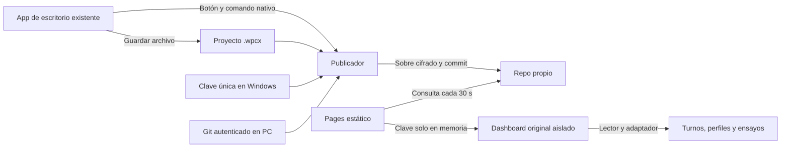

# Arquitectura y contratos

## Archivo y unidad de publicación

Se publica **un proyecto completo**, no una solicitud por sondaje o celda. Su UUID estable es `manifest.proyecto.uuid`. Los sondajes pertenecen al snapshot. Cada envío crea un `operation_id` nuevo; se publica en `data_dir/UUID.json`. Una nueva versión actualiza ese archivo y Git conserva su historia.

Un .wpcx es un ZIP. Debe contener una única entrada `manifest.json` y otra `datos.json`. `manifest.formato='wpc-intercambio'`, `version=1`, SHA-256 de datos en `archivos['datos.json'].sha256`. El proyecto actual contiene sondajes, turnos, filas/corridas, estructuras y ensayos. Se conservan los adjuntos en la copia completa.

## Punto de unión desktop

El módulo recibe funciones `obtenerEstado`, `guardar` e `invocar`. Espera el guardado real y comprueba que el archivo abierto no haya cambiado. El comando Tauri comprueba la ruta canónica contra el archivo que la app tiene abierto. Un proceso separado cifra/publica fuera del hilo de la UI.

Entrada al publicador: JSON por stdin `{ "path": "ruta guardada" }`. Salida por stdout: JSON con `ok`, `confirmed`, `operation_id`, `commit`, `viewer_url`, o bien `ok=false`, `queued` y `message`. No pasar token ni contraseña al navegador o por argumentos. El helper empaquetado recibe las rutas de configuración y cola por variables de proceso no secretas.

## Cifrado y almacenamiento

PBKDF2-HMAC-SHA256, 600000 iteraciones, salt aleatorio de 16 bytes, AES-256-GCM, IV aleatorio de 12 bytes, tag de 128 bits. El AAD exacto es `hidrolog-nube-v1:CLIENT:OPERATION_ID`. El sobre usa `format='hidrolog-demo-encrypted'`, `version=1`, client UUID, operation_id, iterations, salt, iv y ciphertext en base64. El nombre histórico del protocolo se conserva por compatibilidad; no implica que hoy se restrinjan los UUID a los ejemplos iniciales.

El payload lleva versión, fecha, resumen de proyecto y `archive` con nombre, base64 del ZIP completo y SHA-256. También existe un sobre separado para la plantilla, con `project.html_gzip_base64`. La plantilla y los snapshots usan la misma clave elegida por el compañero.

La cola local se escribe **antes** de contactar GitHub; contiene solo sobres cifrados. El acuse se conserva en un archivo aparte tras confirmar. Se reintentan pendientes del mismo proyecto en orden. No se borran. La implementación es una prueba con un emisor; varios PCs simultáneos requieren control adicional de concurrencia y revisión de versiones.

## Publicación del sitio frente a actualización de datos

El workflow publica únicamente la web cuando cambia el código/plantilla. Los snapshots nuevos son datos cifrados leídos desde raw.githubusercontent.com; no necesitan desplegar de nuevo Pages cada vez. Una página visible consulta cada 30 s y puede tener demora por caché. No es streaming ni un backend transaccional.

## Seguridad del visor

El navegador usa Web Crypto, conserva el material de clave solo en memoria y lo borra al bloquear/cerrar. El dashboard se abre en un iframe con sandbox sin acceso al origen padre y política que restringe red. El padre pasa el archivo descifrado por mensajes comprobando la ventana de origen. Se valida SHA-256 antes de adaptar los datos. Los textos se neutralizan antes de llegar a interpolaciones HTML del dashboard.

El runtime espera a que el visor emita `wpc-viewer-ready` y procesa los snapshots de forma secuencial. Si el inicio no termina en el plazo definido, muestra un error. No confirmar una actualización aplicada antes de tener el visor preparado.
